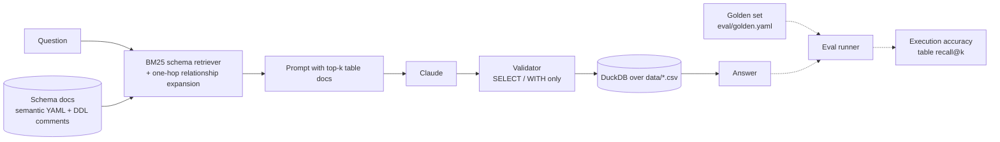

# Text-to-SQL Supply Chain Assistant


Ask a supply-chain warehouse questions in plain English and get back SQL and results.
The assistant retrieves the relevant schema documentation first (RAG), asks Claude to
write a read-only query, runs it on DuckDB, and is scored against a golden test set.

```text
$ python -m t2s.cli "How many active plants do we have?"
tables: mfg_plant
sql:    SELECT COUNT(*) FROM mfg_plant WHERE is_active
tokens in/out: <in>/<out> | latency: <s>s | attempts: 1
```

## How it works



1. **Schema docs**: `t2s/schema_docs.py` builds one document per table. It uses the
   Snowflake semantic model (`semantic/supply_chain_network.yaml`) and the column
   comments in `sql/1_supply_chain_ddl.sql`.
2. **Retrieval**: `t2s/retriever.py` ranks the table docs with BM25, written in the
   standard library only. It then adds a neighbouring table through a declared
   relationship, but only if that table also matched the question.
3. **Generation**: `t2s/generator.py` sends the question and the retrieved docs to
   Claude and asks for a single DuckDB query. If validation or execution fails,
   the error text is sent back once (`retries=1`) so the model can correct itself.
   Tokens, latency and attempts are recorded on every `Answer`.
4. **Guardrail**: `t2s/validator.py` rejects anything that is not one `SELECT` or
   `WITH` statement, including writes hidden after a semicolon.
5. **Execution**: `t2s/executor.py` exposes each CSV in `data/` as a DuckDB view.
6. **Evaluation**: `eval/run_eval.py` runs every golden question and compares the
   result sets, ignoring row order unless the question asks for one. It reports
   execution accuracy and table recall@k, plus token and latency totals.

## Quickstart

```bash
pip install -r requirements.txt
cp .env.example .env          # then add your ANTHROPIC_API_KEY

python -m t2s.cli "Which suppliers have the highest lead time variability?"
python -m t2s.cli --dry "Total shipment cost by carrier"   # retrieval only, no LLM call

python -m eval.run_eval --retrieval-only   # table recall@k, no API key needed
python -m eval.run_eval                    # full run, writes eval/results.md
pytest
```

The default model is `claude-sonnet-5-5`. Set `T2S_MODEL` to use another one.

CI (`.github/workflows/ci.yml`) runs `pytest` and the retrieval-only eval on every
push. It needs no API key, so the full eval is run locally.

## Evaluation

The golden set in `eval/golden.yaml` has 15 questions. Each has a hand-written
reference SQL query and the tables it needs.

| Metric | Result |
|---|---|
| Table recall@3 | _run `python -m eval.run_eval --retrieval-only`_ |
| Execution accuracy | _run `python -m eval.run_eval`_ |

## Project layout

```text
t2s/         retriever, prompt + Claude call, validator, DuckDB executor, CLI
eval/        golden.yaml (15 cases) and the eval runner
tests/       validator, retriever, golden-SQL and retry tests
.github/     CI: pytest + retrieval-only eval (no API key)
data/        11 supply-chain CSV tables
semantic/    Snowflake Cortex Analyst semantic model
sql/         table DDL with column comments
snowflake/   original Snowflake Intelligence setup (Cortex Search, Streamlit app)
```

## Where it fails

_To be filled after a full run of `python -m eval.run_eval`: list the questions marked
`wrong` or `error` in `eval/results.md` and the cause of each (retrieval miss, wrong
join, ambiguous question)._

## Design choices

- **BM25 instead of embeddings.** With 11 tables, lexical retrieval over good docs is
  enough, needs no vector store, and is easy to inspect. Recall@k is tracked, so a
  switch to embeddings can be measured.
- **Relationship expansion with a guard.** Join questions often name only one side of
  a join. Neighbours come from the semantic model's relationships, and a neighbour is
  added only if it also scored above zero, which keeps unrelated tables out of the prompt.
- **Read-only by construction.** The validator allows one `SELECT`/`WITH` statement
  only. DuckDB reads the CSVs through views, so the source data cannot change.
- **Execution accuracy, not string match.** Two different queries that return the
  same rows both count as correct.

## Resume bullets

- Built a RAG-based Text-to-SQL assistant over an 11-table supply-chain warehouse:
  BM25 schema retrieval, Claude SQL generation, a read-only SQL guardrail and DuckDB execution.
- Built an evaluation harness with a 15-question golden set that reports execution
  accuracy and table recall@k, with pytest regression tests for retrieval and SQL safety.
- Added error-feedback retry, per-query token and latency tracking, and a GitHub Actions
  CI pipeline that runs tests and retrieval eval without an API key.

## Credits

The dataset, semantic model, DDL and the `snowflake/` folder come from the Snowflake
Labs quickstart "Supply Chain Assistant with Snowflake Intelligence". The retrieval,
generation, validation, DuckDB execution and evaluation layers in `t2s/`, `eval/` and
`tests/` are new. See `LICENSE`.
